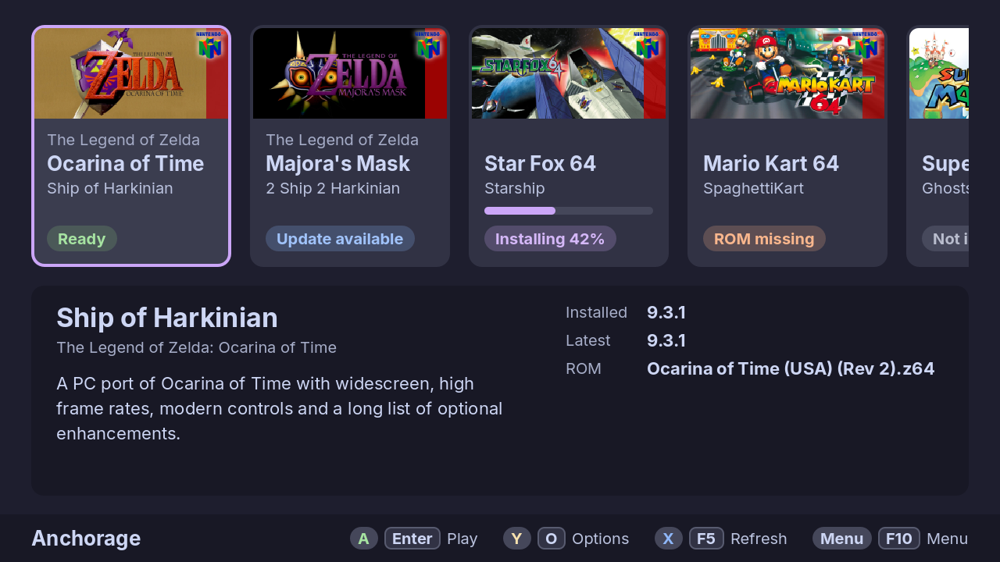
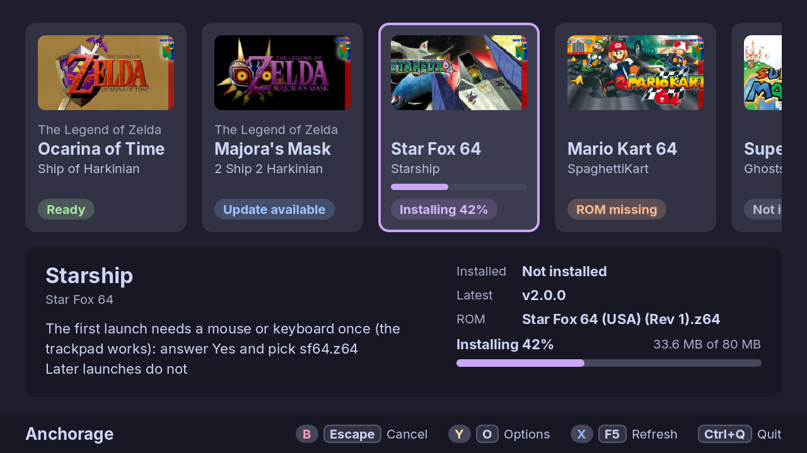
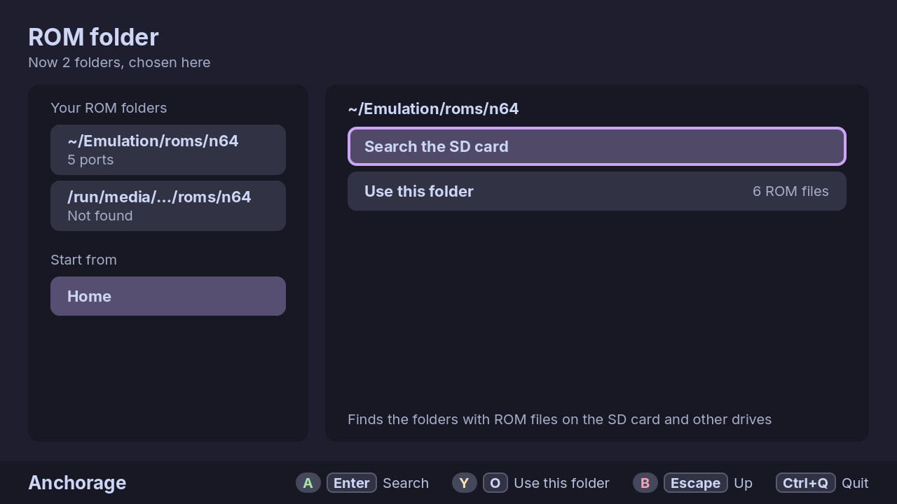
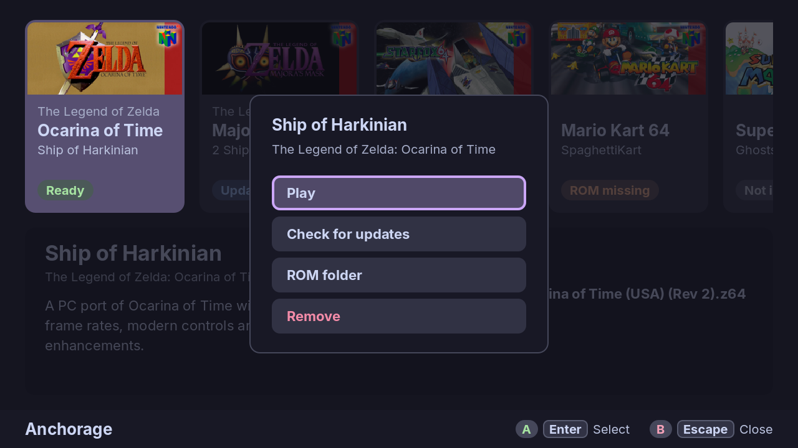
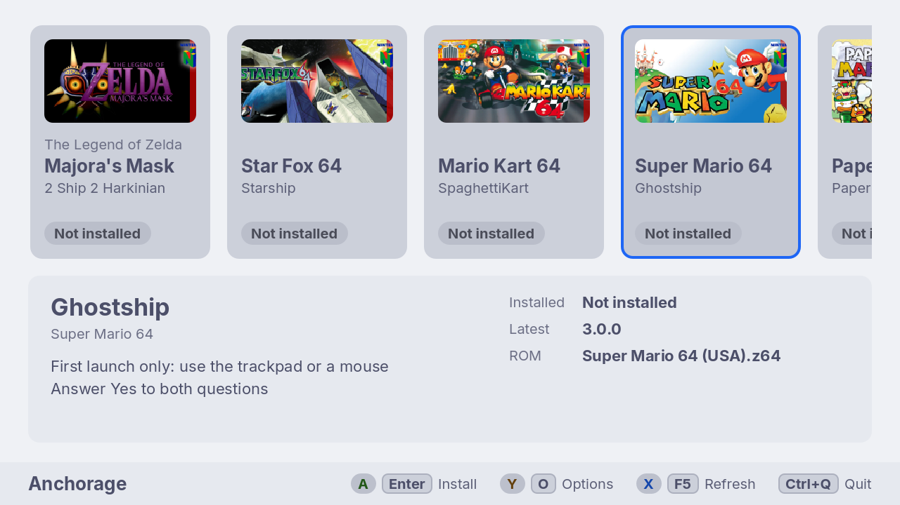

<p align="center">
  
</p>

<h1 align="center">Anchorage</h1>

<p align="center">A controller-first launcher for the HarbourMasters game ports on SteamOS, in Catppuccin colours.</p>

> [!WARNING]
> **Certified, artisanal, vibe-coded slop.**
>
> No human has read this code. An AI wrote all of it while a person said "yeah, looks
> good" and pressed Enter a lot. It downloads programs from the internet, runs them, and
> rummages through your SD card looking for ROMs, all from a couch, with a gamepad. It has
> never met a real Steam Deck. If that sounds like a lot of trust to hand a launcher, it is.
>
> Like any good anchorage, it is a sheltered place to leave your boats, and it says nothing
> about whether they float. Bug reports will be read with great affection and then ignored.



Anchorage (`anchorage`) installs, updates and launches the [HarbourMasters](https://github.com/HarbourMasters)
PC ports of N64 games. It is one non-Steam game in your Steam library: start it in Game
Mode, pick a port with the D-pad, and press A. It finds your own ROMs and hands each port
the right one. It never downloads ROMs.

## Features

- **Seven ports, one row of cards:** Ship of Harkinian, 2Ship2Harkinian, Starship,
  SpaghettiKart, Ghostship, PaperBoat and Lighthouse, each with SteamGridDB cover art and a
  badge that says where it stands: `Not installed`, `Ready`, `Update available`,
  `ROM missing`, or a download in progress.
- **Install, update, remove:** the latest Linux release from the port's GitHub page,
  checked against its size and, when GitHub lists one, its SHA-256 digest. An update keeps the old
  version until the new one has run. Remove deletes the program and keeps your saves and
  settings.
- **Finds your ROMs:** EmuDeck and RetroDECK folders out of the box, the SD card, or a
  folder you pick with the controller. ROMs are matched by checksum, zipped or not, and
  in any byte order.
- **Makes the game files for you:** before the first launch Anchorage puts a copy of the
  right ROM where the port looks for it, so Ship of Harkinian, 2Ship2Harkinian and
  Lighthouse build their game files without asking.
- **Controller first:** everything works with a gamepad alone, with a hint bar that shows
  your current buttons. A keyboard and mouse work too, and every binding can be changed.
- **Catppuccin theming:** all four flavours and all 14 accents.
- **Made for Game Mode:** fullscreen at 1280×720 and up, laid out for the Steam Deck's
  16:10 screen as well as 16:9 TVs and monitors, one Steam shortcut with its own artwork,
  and the ports run as child processes, so quitting a game brings you back.

| | |
|---|---|
|  |  |
|  |  |

## Install

Still here? Bold. Scroll up, reread the warning, then carry on.

### SteamOS (Steam Deck)

Do this once, in Desktop Mode, with Steam left open:

1. Switch to Desktop Mode (Steam button, Power, Switch to Desktop).
2. Open Konsole and run:

   ```sh
   curl -fsSL https://github.com/DisposableSoftware/anchorage/releases/latest/download/install-steamos.sh | bash
   ```

   Leave Steam running: in Desktop Mode the controller only works as a mouse and keyboard
   while Steam is open. To type the command, press Steam + X for the on-screen keyboard.
   Or open this page in Firefox, copy the command, and paste it into Konsole with
   Ctrl+Shift+V.
3. The script downloads everything first. Then it closes Steam for a few seconds (it
   counts down from 5, and Ctrl+C in that time cancels with nothing changed), adds the
   shortcut, and starts Steam again by itself. Steam overwrites its shortcut file when it
   exits, so the file can only be changed while Steam is closed.
4. Go back to Gaming Mode. Anchorage is in your library, under Non-Steam.

The command runs the copy of the script attached to the latest release, so the script
and the files it downloads always come from the same release.

It downloads the latest release's AppImage to `~/Applications/Anchorage.AppImage`,
checks it against the release's `SHA256SUMS`, adds a desktop entry and icon, and adds an
"Anchorage" shortcut with its artwork to every Steam account on the device (native Steam
and Flatpak Steam). It backs up `shortcuts.vdf` before it changes it and never touches
another game's shortcut. It keeps a record of the files it wrote, with their checksums, in
`~/.local/state/anchorage-installer/`, and replaces artwork only while it is still the
image it put there, so art you set in Steam yourself stays. It needs only bash, curl and
coreutils, and asks no questions.

Piping a script from the internet into bash is a leap of faith, so read it first: its
source is [`scripts/install-steamos.sh`](https://github.com/DisposableSoftware/anchorage/blob/main/scripts/install-steamos.sh),
and each release attaches a copy with only that release's version filled in.

- **Update:** run the same command again. When the installed version is the latest, it
  does nothing.
- **Remove:** `curl -fsSL https://github.com/DisposableSoftware/anchorage/releases/latest/download/install-steamos.sh | bash -s -- --uninstall`
  removes the shortcut and only the files the script wrote, as its record lists them;
  artwork you set yourself stays. Your ports, saves and settings stay too; it lists their
  folders so you can delete them. Like the install, it closes Steam for a few seconds
  and starts it again.
- **Look first:** `... | bash -s -- --dry-run` says what it would do and changes nothing,
  and does not close Steam.
- **Close Steam yourself:** `... | bash -s -- --no-steam-restart` never closes Steam. While
  Steam runs, it changes nothing and tells you to exit Steam first (right-click the Steam
  icon in the system tray, Exit), then to run it again: for a Deck with a keyboard
  attached. Over SSH the script does this by itself, as it can't start Steam again on the
  Deck's screen from there.
- **A given version:** run the copy attached to that release, which installs that release:
  `curl -fsSL https://github.com/DisposableSoftware/anchorage/releases/download/vX.Y.Z/install-steamos.sh | bash`.

With Flatpak Steam, allow it to read `~/Applications` once:
`flatpak override --user --filesystem=~/Applications com.valvesoftware.Steam`. The script
reminds you, but does not change Flatpak permissions itself.

### Nix

Try it without installing:

```sh
nix run github:DisposableSoftware/anchorage
```

As a flake input, with the NixOS module:

```nix
{
  inputs.anchorage.url = "github:DisposableSoftware/anchorage";

  # in your NixOS configuration
  imports = [ inputs.anchorage.nixosModules.default ];
  programs.anchorage.enable = true;
}
```

Or with home-manager, which can also write your settings and keybindings:

```nix
{
  imports = [ inputs.anchorage.homeManagerModules.default ];
  programs.anchorage = {
    enable = true;
    settings = {
      appearance = { flavor = "latte"; accent = "blue"; };
      roms.directory = "~/Games/n64";
      ports.check_updates = true;
    };
    keybindings.quit = [ "Ctrl+Q" "Alt+F4" ];
  };
}
```

Both modules also take `package`. If Anchorage has run before, it has already made a
commented-out `~/.config/anchorage/config.ini`, and home-manager will refuse to replace it:
delete that file before setting `settings` (the same goes for `keybindings.ini`). There is
also an overlay, `overlays.default`, which adds `pkgs.anchorage`, and the AppImage builds
with `nix build .#appimage` (x86_64-linux).

### By hand

1. From the [latest release](https://github.com/DisposableSoftware/anchorage/releases/latest),
   download `Anchorage-X.Y.Z-x86_64.AppImage` and `SHA256SUMS` into one folder.
2. Check the download: `sha256sum -c --ignore-missing SHA256SUMS`.
3. Make it executable: `chmod +x Anchorage-X.Y.Z-x86_64.AppImage`.
4. In Steam (Desktop Mode on a Deck): Games, Add a Non-Steam Game to My Library, Browse,
   and pick the AppImage. The release also carries the Steam artwork (`steam-*.png`) if you
   want to set it yourself.

The AppImage needs glibc, your graphics drivers and FUSE 2. Without FUSE, run it with
`--appimage-extract-and-run` or set `APPIMAGE_EXTRACT_AND_RUN=1`.

## Usage

The Steam shortcut is made in Desktop Mode, and Anchorage is played in Gaming Mode. Start
it from your library; it opens fullscreen on the row of cards.

1. Move to a port and press <kbd>A</kbd> to install it. The download shows on the card;
   <kbd>B</kbd> cancels it.
2. When the card says `Ready`, press <kbd>A</kbd> to play. Anchorage shows "Playing" until
   you quit the game, and then you are back on the same card.
3. <kbd>Y</kbd> opens the port's menu: Play, Update, Check for updates, ROM folder and
   Remove. Remove asks first, and keeps your saves and settings.
4. <kbd>Menu</kbd> (the ☰ button, <kbd>Start</kbd> on other gamepads) opens Anchorage's
   own menu: Check for updates and new ports, ROM folder and Quit Anchorage.
5. To quit, choose Quit Anchorage in that menu, or press <kbd>B</kbd> on the cards with
   nothing to cancel and confirm with Quit (focus starts on Stay).

Anchorage checks for updates and new ports when it starts (at most once an hour) and when
you press <kbd>X</kbd>. A card with `Update available` updates on <kbd>A</kbd>, and its menu
still has Play. A new port gets its card at the end of the row, marked `New` until you
move to it.

**Controller layout:** Anchorage expects the Xbox-style gamepad that Steam Input gives a
non-Steam game: <kbd>A</kbd> accepts, <kbd>B</kbd> goes back. If the buttons do nothing, open
the shortcut's controller settings and choose Steam's Gamepad template. Some ports ask
questions with a mouse-only dialog on their first launch (see the table below); answer
them with the trackpad, a mouse or a keyboard, once.

On a desktop, run `anchorage` (or the AppImage). The window has the Wayland app ID
`io.github.DisposableSoftware.Anchorage`.

### Supported ports

| Game | Port | ROM versions | First launch |
|---|---|---|---|
| The Legend of Zelda: Ocarina of Time | [Ship of Harkinian](https://github.com/HarbourMasters/Shipwright) | N64 1.0 to 1.2 (US, JP, PAL), GameCube and Master Quest | The first launch makes the game files from your ROM. If it then asks to run, close it and press Play again |
| The Legend of Zelda: Majora's Mask | [2Ship2Harkinian](https://github.com/2ship2harkinian/2ship2harkinian) | US 1.0, US GameCube | The first launch makes the game files from your ROM. If it then asks to run, close it and press Play again |
| Star Fox 64 | [Starship](https://github.com/HarbourMasters/Starship) | US 1.0, US 1.1 | First launch only: use the trackpad or a mouse. Answer Yes, then pick `sf64.z64` |
| Mario Kart 64 | [SpaghettiKart](https://github.com/HarbourMasters/SpaghettiKart) | US | First launch only: answer its questions with the trackpad or a mouse |
| Super Mario 64 | [Ghostship](https://github.com/HarbourMasters/Ghostship) | US, JP | First launch only: use the trackpad or a mouse. Answer Yes to both questions |
| Paper Mario | [PaperBoat](https://github.com/HarbourMasters/PaperBoat) | US | First launch only: answer its questions with the trackpad or a mouse |
| Banjo-Kazooie | [Lighthouse](https://github.com/HarbourMasters/Lighthouse) | US 1.0, US 1.1, PAL, JP | The first launch makes the game files from your ROM. If it then asks to run, close it and press Play again |

Later launches need nothing. The detail panel shows the first-launch note until the port
has made its game files, and lists the ROM versions it accepts while none is found.

### ROM folder

Anchorage uses the first of these that holds ROM files:

1. The folder set as `[roms] directory` in `config.ini`.
2. The folder you chose in the app.
3. EmuDeck's ROM folder, read from `~/.config/EmuDeck/settings.sh` (or the older
   `~/emudeck/settings.sh`), and RetroDECK's, read from its `retrodeck.json` (or the older
   `retrodeck.cfg`). Both are only read, never run.
4. `~/Emulation/roms/n64`, `~/retrodeck/roms/n64` and `~/Roms/n64`.
5. On the SD card and other drives under `/run/media`: `Emulation/roms/n64`,
   `retrodeck/roms/n64`, `roms/n64`, `ROMs/n64` or `n64`, in any upper or lower case.
6. A search of the SD card and other drives, four folders deep.

To pick a folder yourself, choose ROM folder in a port's menu, or press <kbd>A</kbd> on a
`ROM missing` card and <kbd>A</kbd> again on the hint it shows. The chooser starts in the current folder, lists your home and every
drive, shows how many ROM files each folder holds, and has Search the SD card at the top.
Press <kbd>Y</kbd> to use the folder you are in. Your choice is remembered in `state.ini`.

Anchorage reads `.z64`, `.n64` and `.v64` files and `.zip` files (every ROM inside them, up
to 64 MiB each), directly in that folder, and identifies them by SHA-1. It only reads the
ROM folder: it never writes, moves, renames or deletes anything there, and it never uploads
anything. Before a port's first launch it writes a copy of the ROM into that port's own data
folder, and deletes the copy once the port has made its game files. Anchorage never
downloads ROMs: bring your own.

## Keyboard and gamepad

These are the defaults. The hint bar at the bottom of the screen always shows the current
ones.

| Binding | Action | Gamepad | Keyboard |
|---|---|---|---|
| `up` `down` `left` `right` | Move | <kbd>D-pad</kbd>, <kbd>Left stick</kbd> | <kbd>↑</kbd> <kbd>↓</kbd> <kbd>←</kbd> <kbd>→</kbd> |
| `accept` | Install, update or play; press the focused button | <kbd>A</kbd> | <kbd>Enter</kbd> |
| `back` | Go back, close a menu, cancel a download; on the cards, ask to quit | <kbd>B</kbd> | <kbd>Escape</kbd> |
| `options` | Open the port's menu; in the ROM folder chooser, use this folder | <kbd>Y</kbd> | <kbd>O</kbd> |
| `refresh` | Check for updates and rescan the ROM folder | <kbd>X</kbd> | <kbd>F5</kbd> |
| `menu` | Open the app menu: Check for updates and new ports, ROM folder, Quit Anchorage | <kbd>Menu</kbd> (<kbd>Start</kbd>) | <kbd>F10</kbd> |
| `quit` | Quit Anchorage at once | | <kbd>Ctrl</kbd>+<kbd>Q</kbd> |

With a mouse, pointing at a card focuses it, and a click does what <kbd>A</kbd> does. A
click on a hint in the bar at the bottom does what its button does, so Menu opens the app
menu.

## Configuration

| What | Where |
|---|---|
| Settings | `~/.config/anchorage/config.ini` |
| Keybindings | `~/.config/anchorage/keybindings.ini` |
| What Anchorage remembers | `~/.local/state/anchorage/state.ini` |
| Installed ports, and each port's saves and settings | `~/.local/share/anchorage/ports/<port>/` |
| Cover art | `~/.cache/anchorage/art/` |

These follow `$XDG_CONFIG_HOME`, `$XDG_STATE_HOME`, `$XDG_DATA_HOME` and `$XDG_CACHE_HOME`
when they are set.

The first time Anchorage starts, it creates whichever of `config.ini` and `keybindings.ini`
is missing, with every option listed at its default but commented out: remove the `# ` from
a line to change it. It never writes to a file that already exists, so configs from
dotfiles or home-manager are left alone. Changes apply when Anchorage restarts. The same
lists are in [`app/data/config.example.ini`](app/data/config.example.ini) and
[`app/data/keybindings.example.ini`](app/data/keybindings.example.ini).

```ini
[window]
# size when not fullscreen, in logical px (at least 1280x720)
width = 1280
height = 720

[appearance]
# latte, frappe, macchiato or mocha
flavor = mocha
# rosewater, flamingo, pink, mauve, red, maroon, peach, yellow, green,
# teal, sky, sapphire, blue or lavender
accent = mauve

[roms]
# unset: Anchorage finds the folder, or you choose it in the app; set: this wins
directory = ~/Roms/n64

[ports]
check_updates = true
```

```ini
# keybindings.ini: separate keys with ';', leave empty to unbind
[keybindings]
quit = Ctrl+Q;Alt+F4
refresh = F5;Pad:X;Pad:RightShoulder
```

A key is optional `Ctrl+`, `Shift+`, `Alt+` or `Super+` and a Godot key name (`Enter`,
`Escape`, `Up`, `Q`, `F4`). A gamepad input is `Pad:` and a button (`A`, `B`, `X`, `Y`,
`Back`, `Guide`, `Start`, `LeftShoulder`, `RightShoulder`, `LeftStick`, `RightStick`,
`DPadUp` and so on), a stick direction (`LeftStickUp`, `RightStickLeft`, ...) or a trigger
(`LeftTrigger`, `RightTrigger`). Button names follow the Xbox layout that Steam Input
reports. Unknown names and keys are skipped with a warning.

`state.ini` holds what Anchorage remembers between runs: the installed and latest version
of each port, the version that made its game files, the ROM copy it placed, the last update
check, the ROM scan cache and the ROM folder you chose. It is not a settings file; delete it
to make Anchorage forget.

## Status and known limitations

- **Untested on a real Steam Deck at the time of writing.** Everything on Steam's side is
  unconfirmed: the installer's shortcut and artwork showing up in a real Steam client, Game
  Mode and gamescope, and Steam Input. So are the SD card's real mount names. All of it has
  only been tried against fakes, in a headless sway and on a NixOS desktop. The code follows
  the documented behaviour of each, and a Deck may still disagree.
- Four ports need a mouse, trackpad or keyboard on their first launch (see the table). That
  is their dialog, not Anchorage's.

## Development

What Anchorage does is written down in [`spec/`](spec/README.md): every behaviour is a
numbered requirement, and the code follows it. Changes go spec first, then code, then a
check against the spec; [`CLAUDE.md`](CLAUDE.md) describes the workflow. It is a
[Godot](https://godotengine.org) 4 project in `app/`, in GDScript, with no addons.
`scripts/test.sh` runs the unit tests and checks the keybinding and settings tables in the
spec against the code and the example files.

```sh
nix develop                 # godot, gdlint, gdformat
godot --headless --path app --import   # once per checkout: imports the font
godot --path app            # run it
godot --path app -- --fake-ports installing   # demo data instead of real downloads
scripts/test.sh             # unit and spec tests, headless
cd app && gdlint src tests && gdformat --check src tests
nix build                   # ./result/bin/anchorage
nix build .#appimage        # the SteamOS AppImage
nix flake check             # tests, lint, format and the installer test
git config core.hooksPath .githooks   # once per clone: ROM guard and release check on push
```

The scripts in [`scripts/manual/`](scripts/manual) drive the app in a headless sway
(`scripts/manual/headless.sh`), so they work with the screen locked: focus, screenshots of
every state (`shots.sh`, `rom-folder.sh`), the window sizes from 720p to 4K, the AppImage,
the SteamOS installer against fake Steam folders (`steam-install.sh`), and an end-to-end
run that installs and starts the real ports (`e2e.sh`). The README screenshots are
1280×720 shots of the demo data, with the cover art fetched from SteamGridDB at the time.
The pre-push hook refuses ROMs and large files (`scripts/check-no-roms.sh`).

The port list is `app/data/ports.json`, and Anchorage fetches it from `main`, so a new port
needs no new release. [`docs/adding-a-port.md`](docs/adding-a-port.md) covers the fields,
finding ROM hashes, bumping the catalog `version` and testing with `ANCHORAGE_CATALOG_URL`.

## Credits

The colours are [Catppuccin](https://catppuccin.com), a community-driven pastel theme by the [Catppuccin organisation](https://github.com/catppuccin/catppuccin) and its contributors. The palette is theirs, not ours, and is MIT-licensed. The files in `data/themes/` carry the values from the [official palette](https://catppuccin.com/palette).

Anchorage is built with the [Godot Engine](https://godotengine.org) (MIT), and the
AppImage carries Godot's official export template. The font is
[Inter](https://github.com/rsms/inter) by The Inter Project Authors, under the
SIL Open Font License 1.1 ([`app/fonts/LICENSE.txt`](app/fonts/LICENSE.txt)).

The ports are the work of [HarbourMasters](https://github.com/HarbourMasters) and their
contributors: [Shipwright](https://github.com/HarbourMasters/Shipwright),
[2ship2harkinian](https://github.com/2ship2harkinian/2ship2harkinian),
[Starship](https://github.com/HarbourMasters/Starship),
[SpaghettiKart](https://github.com/HarbourMasters/SpaghettiKart),
[Ghostship](https://github.com/HarbourMasters/Ghostship),
[PaperBoat](https://github.com/HarbourMasters/PaperBoat) and
[Lighthouse](https://github.com/HarbourMasters/Lighthouse). Anchorage only downloads their
releases and starts them; each keeps its own licence.

The cover art comes from [SteamGridDB](https://www.steamgriddb.com) and belongs to its
artists. It is not in this repository or the AppImage: Anchorage downloads it from
SteamGridDB to your cache, and the screenshots above show it.

| Game | Artist | Asset |
|---|---|---|
| The Legend of Zelda: Ocarina of Time | Corgana | [steamgriddb.com/grid/30300](https://www.steamgriddb.com/grid/30300) |
| The Legend of Zelda: Majora's Mask | Corgana | [steamgriddb.com/grid/30298](https://www.steamgriddb.com/grid/30298) |
| Star Fox 64 | Corgana | [steamgriddb.com/grid/30303](https://www.steamgriddb.com/grid/30303) |
| Mario Kart 64 | Corgana | [steamgriddb.com/grid/30299](https://www.steamgriddb.com/grid/30299) |
| Super Mario 64 | Corgana | [steamgriddb.com/grid/30304](https://www.steamgriddb.com/grid/30304) |
| Paper Mario | Corgana | [steamgriddb.com/grid/30301](https://www.steamgriddb.com/grid/30301) |
| Banjo-Kazooie | Corgana | [steamgriddb.com/grid/30295](https://www.steamgriddb.com/grid/30295) |

The app icon and Anchorage's own Steam artwork are original, drawn for this project
([`tools/steam-art/`](tools/steam-art)), with no third-party artwork in them.

Anchorage is not affiliated with HarbourMasters, SteamGridDB, Valve or Nintendo. Game names
are trademarks of their owners.

## License

MIT, see [LICENSE](LICENSE).
